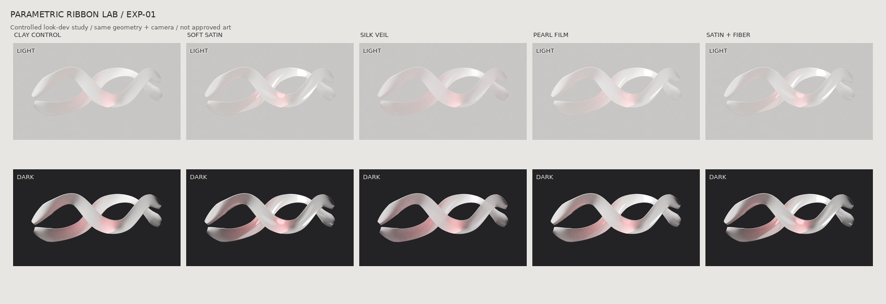

# EXP-01 — Controlled material and lighting comparison (2026-11-12)

[Original V1 contact sheet](../renders/exp01-v01-contact-sheet.jpg)

**Outcome: partial engineering progress, visual design not approved.** This experiment intentionally uses neutral, generic surfaces and publicly shareable shaders, not any proprietary art.

## Evidence

- Three render passes were executed using real 3D ribbon meshes and Blender Cycles.
- Final pass: 5 looks × 2 environments, **64 samples** per frame, CPU, 900×520 images. Individual PNGs and editable Blender scene are provided as an artifact of the EXP-01 workflow.
- The same base geometry, camera and lighting positions were used across the five looks in each pass.
- V1 was invalid for aesthetic comparison: camera orthographic scale was interpreted incorrectly, clipping the ends of the object.
- V2 fixed framing and added more visible curvature, but the lighting cast a broad pink hue, and 24-sample Cycles images had conspicuous noise.
- V3 reduced red spill, added a directional glossy lobe to satin, adjusted background tones and increased to 64 samples. It is still a diagnostic material test.

## Visual assessment

| Dimension | Result |
| --- | --- |
| Camera framing | **PASS for this neutral geometry** — shape no longer cropped |
| Scene material variation | **PARTIAL** — satin is distinguishable from veil, but differences remain subtle at contact-sheet resolution |
| Satin highlights | **PARTIAL** — directional reflections now follow some curves, but read as solid polymer rather than luminous textile |
| Translucence / veiling | **FAIL vs. desired lightweight textile effect** — physically defined transmission and 22% transparent mix are not enough |
| Fiber appearance | **FAIL as visible structure** — roughness-only variation remains largely invisible; this does not establish a believable weave |
| Local red accent | **PARTIAL** — narrower than V1/V2, still too bright at a few points and not fully integrated into a recessed 3D surface |
| Light environment | **PARTIAL** — lighter and darker variants are functional, but light background still reads neutral gray rather than warm ivory |
| Noise / final presentation | **NOT APPROVED** — 64 samples without a supported denoiser still show some visible grain |
| Browser runtime and motion | **NOT TESTED** — neither Three.js parity nor animated deformation was implemented |

**No material can be declared commercially premium from this study.** Soft Satin with controlled specular is the most useful base *for further research*, not an approved aesthetic.

## Most important new hypothesis for EXP-02

The desired impression cannot be produced simply by tuning roughness, transmission and anisotropy of a mostly opaque sheet. Explore a **layered, directional optical material**:
- coherent transparent/partial-opaque thin surfaces whose edge thickness remains readable,
- a small number of *surface-bound* longitudinal filaments with density constrained in screen space,
- layered sheen and Fresnel-driven edge reflectance, not a uniform bright plastic highlight,
- deliberate depth and separation between surfaces so crossing order is meaningful,
- truly localized warm-white and noble-red highlights,
- anti-aliasing and mobile downsampling checks **before** increasing filament count.

Do not reproduce the old strategy of dozens of floating line meshes; it produced moiré and destroyed the apparent volume.

## EXP-03 gate

Motion remains **blocked by unresolved look-development quality**. It should deform actual surface controls and recompute normals and highlights, not warp a rendered raster or animate independent stripes. The separate motion inspiration is not stored publicly.

## Cost / scope

Only generic geometry, experimental scripts and a small contact sheet were committed to this public repository. Private references and approved brand designs must remain outside public Git history.
