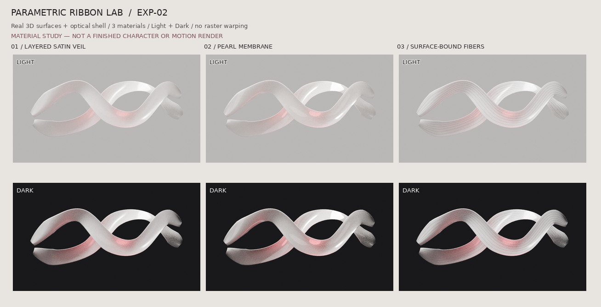
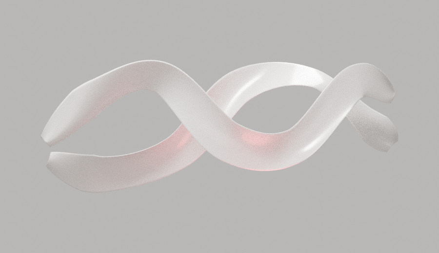
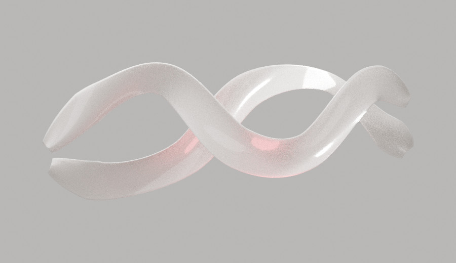
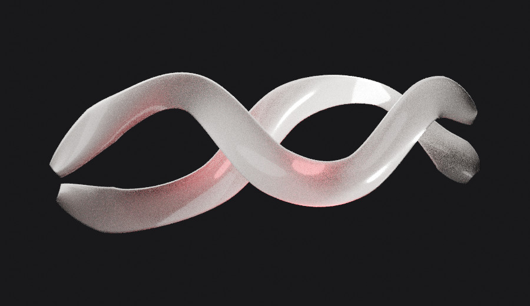
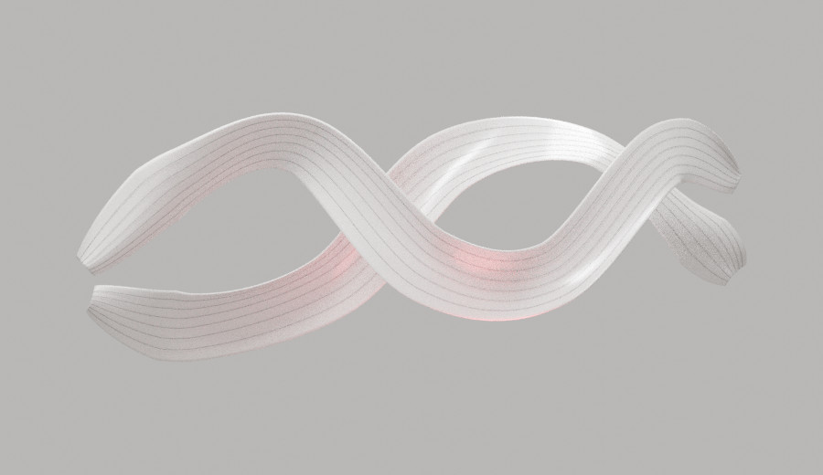
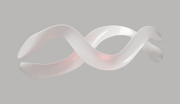
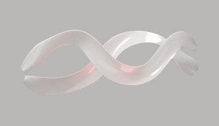
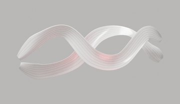
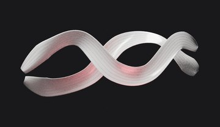

# EXP-02 — Layered Optical Material

The images below are **actual Blender Cycles renders of parametric 3D surfaces**, not generated illustrations or raster distortions. **Experimental; not an approved character.**

| Material | Light | Dark |
|---|---|---|
| 01 / LAYERED SATIN VEIL |  |  |
| 02 / PEARL MEMBRANE |  |  |
| 03 / SURFACE-BOUND FIBERS |  |  |

## Mobile downsample check (360 px wide)

**01 / LAYERED SATIN VEIL**
 

**02 / PEARL MEMBRANE**
 

**03 / SURFACE-BOUND FIBERS**
 

## Technical record

- 2 neutral base ribbon meshes with a secondary physically offset optical shell
- Surface Fresnel response and directional glossy layer computed by Cycles
- Variant C adds 6 host-surface filament tracks per ribbon; aliasing requires visual inspection
- White area lights and one selective red light, shared scene/camera
- 48 samples at 900×520; denoiser unavailable in apt Blender build
- Material comparison only: no motion or mobile GPU rendering yet
- All PNGs and editable Blender project are attached to the GitHub Actions artifact

**Quality gate:** green CI means the images exist, not that they meet the premium aesthetic target.

## Visual review — 2026-11-14

**Pipeline verified**: six actual Cycles renders, editable Blender scene, published desktop gallery and mobile downsample previews. This is not a motion engine, and there is no raster deformation.

- **Layered Satin Veil:** the most balanced of these preliminary looks. The secondary shell creates a restrained edge reflection. However, the carrier remains too solid and reads as satin-coated polymer, not the approved ethereal multi-layer material.
- **Pearl Membrane:** has brighter glossy edges but the effect is close to Satin Veil at screen scale. Not sufficiently distinct to justify selecting it.
- **Optical Fibers:** six surface-bound tracks per ribbon show clear parallel striping. It remains too decorative and visibly line-based for the desired finish. **Reject this implementation**; do not increase the number of tracks.
- **Lighting:** localized soft red and white lights are visible; the light theme remains more neutral gray than intended warm ivory. Cycles noise is visible at 48 samples without denoising.
- **Rendering:** geometry is 3D and the optical shell is an additional actual surface offset from the carrier. No shader parameter on its own has yet achieved the premium visual target.

**Result:** EXP-02 proves real layered shaders are functional, but **does not pass the visual quality gate**. The next useful technical test would isolate a more translucent carrier with spatially coherent optical sheen, and separately validate that material in real-time WebGL. Do not claim this static material matrix as the finished or animated Konstanty.
